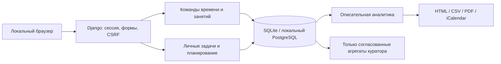

# Устройство учебного приложения

## Назначение и модель процесса

«Такт» связывает текущую задачу, план времени, учебное занятие и запись фактической работы. Данные принадлежат студенту. Приложение помогает пересматривать план и читать собственный учёт; оно не определяет успеваемость и не доказывает образовательный эффект.

AS IS — учебное предположение: студент хранит дедлайны и оценки длительности в разных заметках, не сопоставляет планы с записанным временем. TO BE: личный каталог задач/дисциплин, недельный бюджет, календарь, добровольное сообщение агрегатов куратору и воспроизводимая аналитика. Обследование реальной группы и подтверждение этого предположения ещё не выполнены; демоданные не являются результатами исследования студентов.

run_local.py — вход для IDE, автоматически проверяющий конфигурацию и применяющий миграции. Сервис слушает loopback. main.py предоставляет команды Django, включая seed_demo для отдельного существующего пустого аккаунта. Установка и браузерная приёмка — ACCEPTANCE.md.

## Модель данных и права

В предметной схеме12 таблиц: Subject, TaskCategory, Task, TimeEntry, WeekPlan, StudyGoal, StudySession, StudentProfile, StudyGroup, GroupMembership, Feedback, TaskAttachment. DemoDataset и PrivateFileBlob — технические таблицы, не засчитываемые в норму. Служебные таблицы Django также исключены. Миграции определяют структуру SQL, seed_demo создаёт вымышленный набор, reports/requirements-audit-v1.json перечисляет поля.

Task ссылается на собственные дисциплину/категорию; TimeEntry — на задачу. StudySession связывает задачу с плановым интервалом и одной фактической записью после завершения. StudyGoal задаёт цель за ограниченный период. WeekPlan — недельный бюджет с понедельника. TaskAttachment хранит метаданные приватного файла; содержимое находится в локальном приватном каталоге либо PrivateFileBlob.

| Роль | Доступ |
|---|---|
| Студент | Собственные задачи, время, планы, документы и профиль |
| Куратор группы | Состав собственной группы и агрегаты только добровольно согласившихся участников |
| Администратор сервиса | Аккаунты, группы, целостность и обращения; личные тексты задач не открываются автоматически |

Создатель группы становится куратором. Членство и согласие share_summary разделены; согласие можно отозвать. Идентификаторы задач/файлов/справочников проверяются по владельцу на сервере. Глобальный staff не подменяет согласие студента. Cookie имена отличаются от остальных локальных проектов.

## Согласованность и расчёты

Запись/исправление времени, сохранение/завершение сессии сериализуются общей блокировкой пользователя. Лимит1440минут в сутки пересчитывается внутри транзакции. Исправление исключает прежнюю запись и проверяет день назначения. Завершение занятия идемпотентно: ссылка на одну фактическую запись защищена ограничением БД. Ручной повтор обычной формы времени пока может создать новую запись; для исправлений есть отдельный подтверждаемый сценарий.

Запланированные занятия не пересекаются; отменённые не занимают интервал. Календарь разделяет занятие по локальным дням. При завершении факт записывается за дату начала согласно показанной форме — это отдельное допущение учёта, не посекундный таймер. iCalendar экспортирует планы/дедлайны, а не второй набор фактических событий; ограничения описаны в CALENDAR.md.

План аналитики относится к текущим дедлайнам, факт — к датам работы. Средняя абсолютная ошибка оценки вычисляется только для завершённых задач с записями; неполный учёт меняет результат. Сравнение двух равных непересекающихся периодов описательное. Нулевой знаменатель не превращается в нулевой процент. Изменение минут не является причинным эффектом приложения; текущие оценки и сроки не восстанавливают исторический снимок.

Файлы проверяются по типу/размеру/владельцу и скачиваются только после авторизации. Перенос в БД проверяет SHA и сохраняет оригинал. Обслуживание осиротевших DB-файлов сначала выполняется в dry-run с возрастом/повторной проверкой; реальные личные файлы при разработке не удалялись.

## Проверенные и открытые условия

Выполнены чистая установка с пустой SQLite и11 реальных Chrome-проверок на1440/390px. Шесть снимков просмотрены, исправлены поля дат и мобильная таблица исследования. Набор содержит75 тестов; PostgreSQL-конкуренция ранее проверена отдельными соединениями и не подменяется SQLite. PDF проверен при отрисовке на одной и четырёх страницах.

Аудит:12 предметных таблиц,10 публичных руководств,10 личных разделов,7 собственных staff-страниц и3 роли. Метод Python AST без docstring/tests/migrations плюс непустые HTML/CSS-строки дал1733 смешанные единицы. Это техническая методика, а не утверждённый стандарт логических строк; порог2000 по ней ещё открыт. Нужные дальнейшие сценарии — защита повторного ручного ввода, проверка достижимости недельного плана и точный журнал завершений задач. Исходники не дописываются ради счётчика.

Для итогового отчёта нужны согласованный протокол исследования, оформление ТЗ/процессов/иллюстраций по шаблону и финальная проверка руководителем. История коммитов отдельно учитывается в PROGRESS.md.
